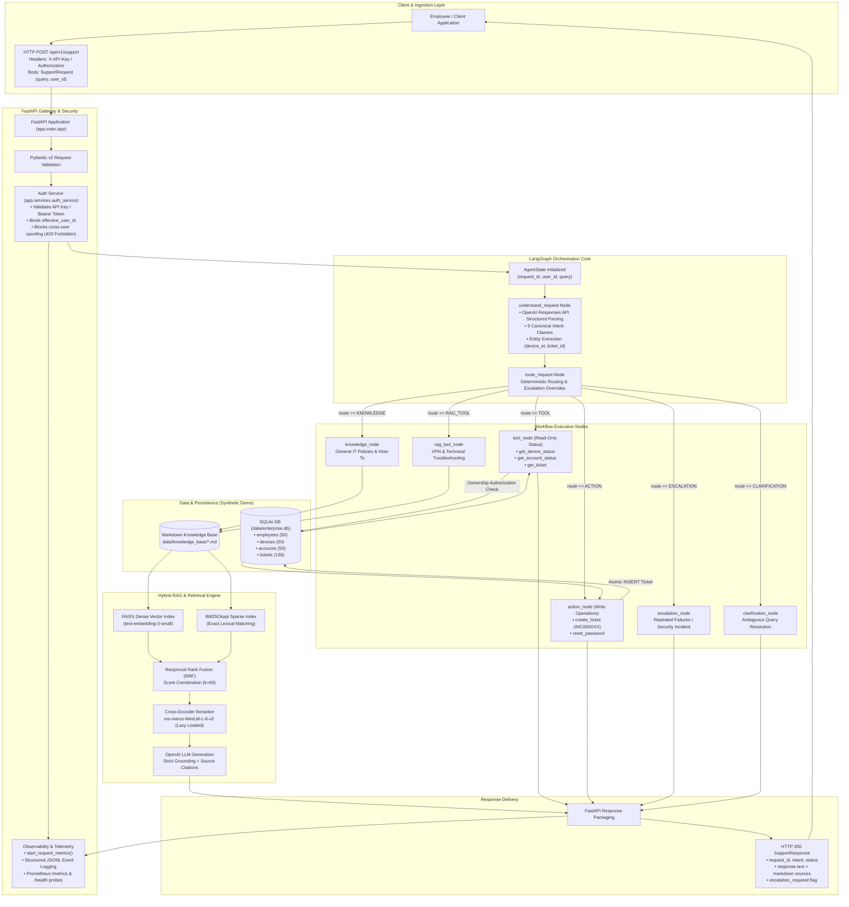
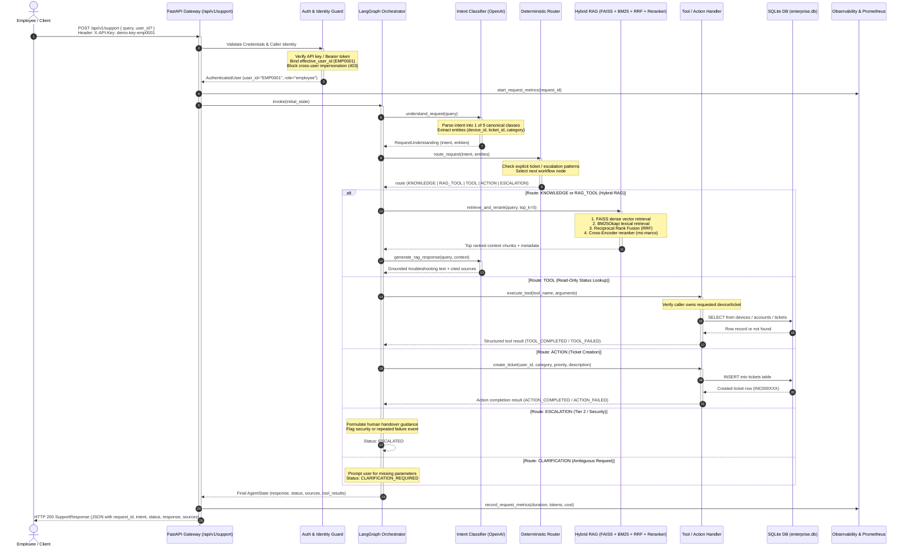
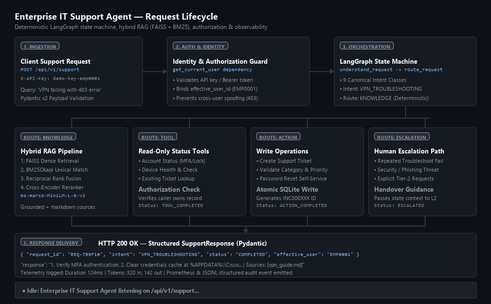

# Enterprise IT Support & Resolution Agent

[](https://github.com/kris9117/Rag_agent_/actions/workflows/ci.yml)
[](https://www.python.org/)
[](https://fastapi.tiangolo.com/)
[](https://langchain-ai.github.io/langgraph/)
[](LICENSE)

A production-style Tier-1 enterprise IT support agent built with **FastAPI**, **LangGraph**, **Hybrid RAG (FAISS + BM25)**, **Cross-Encoder Reranking**, and **SQLite**. Designed with deterministic state-machine guardrails to resolve employee technical issues—including VPN connection failures, password resets, account lockouts, hardware health inspections, and support ticket creation—while enforcing zero-trust caller identity, horizontal authorization guards, structured observability, and reliable human escalation boundaries.

---

## Table of Contents

- [Problem Statement](#problem-statement)
- [Key Capabilities](#key-capabilities)
- [High-Level Design](#high-level-design)
- [Detailed Request-Flow Architecture](#detailed-request-flow-architecture)
- [Animated Request Flow](#animated-request-flow)
- [Technology Stack](#technology-stack)
- [Repository Structure](#repository-structure)
- [Quickstart: Clean Clone Setup](#quickstart-clean-clone-setup)
- [Environment Configuration](#environment-configuration)
- [Index Building & Ingestion](#index-building--ingestion)
- [Testing, Linting & Verification](#testing-linting--verification)
- [Reproducible Evaluation & Benchmarks](#reproducible-evaluation--benchmarks)
- [API Reference & Realistic Examples](#api-reference--realistic-examples)
- [Security Model & Honest Limitations](#security-model--honest-limitations)
- [Docker & Container Deployment](#docker--container-deployment)
- [Roadmap & Contribution](#roadmap--contribution)
- [License](#license)

---

## Problem Statement

Enterprise IT help desks handle thousands of repetitive support requests every month: VPN authentication failures, MFA resets, hardware health checks, and incident logging. 

Conventional unconstrained LLM chatbots fall short in enterprise environments:
1. **Hallucinated Guidance & Stale Policies**: Off-the-shelf LLMs invent troubleshooting steps or refer to outdated policies without grounding in company-specific runbooks.
2. **Missing Identity & Authorization**: LLM wrappers frequently accept user-supplied IDs from client payloads, allowing employees to view colleagues' tickets or devices (Horizontal Privilege Escalation).
3. **Non-Deterministic Execution Loops**: Unbounded ReAct loops can hallucinate tool arguments, enter infinite cycles, or trigger destructive side effects.
4. **Silent Failure Masking**: Traditional implementations often report `200 OK` or `COMPLETED` even when database inserts fail or records do not exist.

This project addresses these challenges by implementing a **bounded LangGraph state machine** combined with **hybrid information retrieval (exact lexical + dense semantic)**, **cross-user authorization enforcement**, and **deterministic escalation overrides**.

---

## Key Capabilities

* **Deterministic LangGraph Workflow**: State machine routing across 9 canonical intent classes with deterministic pattern overrides for ticket requests and human escalation.
* **Hybrid RAG Pipeline**: Combines dense semantic vector search (**FAISS**) with sparse lexical search (**BM25Okapi**) fused via Reciprocal Rank Fusion (RRF, $k=60$).
* **Cross-Encoder Reranking**: Locally reranks fused candidates with `cross-encoder/ms-marco-MiniLM-L-6-v2` (lazy-loaded for fast cold starts) to ensure top precision.
* **Source Citations & Grounding**: Every knowledge-based response terminates with structured document ID and section citations (`**Sources:**`).
* **Zero-Trust Identity Enforcement**: Caller identity is derived strictly from authentication (`X-API-Key` / Bearer token), blocking cross-user spoofing with `HTTP 403 Forbidden`.
* **Operational IT Tools**: Read-only tools for account status, device connectivity, and ticket inspection, backed by cross-user ownership verification.
* **Atomic Incident Actions**: Write operations to create IT support tickets with auto-generated `INC` identifiers and strict category/priority validation.
* **Automated Escalation Triggers**: Detects repeated troubleshooting failures, explicit Tier-2 support requests, and critical security threats (e.g. phishing).
* **Telemetry & Prometheus Observability**: In-memory P50/P90/P95/P99 latency tracking, token usage accounting, rotating JSONL audit logs, and `/metrics` exposition.
* **Kubernetes Health Probes**: Dedicated `/health`, `/health/live`, and `/health/ready` endpoints verifying SQLite connectivity and index file readiness.
* **Hardened Containerization**: Multi-stage `Dockerfile` running as unprivileged non-root user `appuser` (UID 1000) with container healthchecks.
* **100% Offline Test Harness**: 46 automated unit and integration tests executing with temporary database cloning and mocked LLM/RAG services (68% statement coverage).

---

## High-Level Design

The system separates client ingestion, security, orchestration, retrieval, operational data, and observability into modular layers:



---

## Detailed Request-Flow Architecture

The sequence below illustrates how an incoming request traverses validation, authentication, orchestration, retrieval, and response formatting:



---

## Animated Request Flow

The animation below visualizes the 5-step lifecycle of an incoming support request across all functional paths:



*Editable source assets:*
* [docs/assets/request-flow.mmd](docs/assets/request-flow.mmd) — Mermaid sequence diagram definition
* [docs/assets/request-flow.svg](docs/assets/request-flow.svg) — High-resolution vector illustration

### Animation Stages:
1. **Ingestion**: Client issues an authenticated `POST /api/v1/support` request.
2. **Auth & Identity Guard**: FastAPI validates the Pydantic payload, verifies demo credentials, and binds `effective_user_id`.
3. **LangGraph State Machine**: `understand_request` classifies query intent into 1 of 9 classes; `route_request` deterministically selects the branch.
4. **Branch Execution**:
   - `KNOWLEDGE`: Hybrid RAG search (FAISS + BM25) $\to$ RRF $\to$ Cross-Encoder reranking $\to$ Grounded response.
   - `TOOL`: Entity ownership validation $\to$ Read-only DB status lookup.
   - `ACTION`: Validation $\to$ Atomic SQLite insert $\to$ Incident ticket generated.
   - `ESCALATION`: Repeated failure detection $\to$ Structured human handover.
5. **Response Delivery**: FastAPI delivers `SupportResponse` with correlation ID, intent, verified answer, citations, and telemetry.

---

## Technology Stack

| Layer | Component | Version / Specification | Purpose |
| :--- | :--- | :--- | :--- |
| **API Framework** | FastAPI | `0.141.1` | Asynchronous REST API, dependency injection, and schema enforcement |
| **Data Validation** | Pydantic | `2.10.6` | Request/response models and OpenAI structured output parsing |
| **Agent Core** | LangGraph | `1.2.11` | Stateful cyclical workflow engine with conditional branching |
| **LLM Provider** | OpenAI Responses API | `gpt-5.6-luna` | Structured intent classification and grounded RAG answer generation |
| **Dense Embeddings** | OpenAI Embeddings | `text-embedding-3-small` | 1536-dimensional semantic dense document representations |
| **Dense Vector Index** | FAISS | `faiss-cpu==1.10.0` | In-memory similarity search over dense policy chunk vectors |
| **Lexical Search** | Rank-BM25 | `rank-bm25==0.2.2` | Exact keyword and technical term scoring (BM25Okapi) |
| **Neural Reranker** | Sentence-Transformers | `cross-encoder/ms-marco-MiniLM-L-6-v2` | Deep cross-attention reranking of top candidate passages |
| **Demo Database** | SQLite & SQLAlchemy | `2.0.38` | Synthetic relational store (employees, devices, accounts, tickets) |
| **Observability** | Prometheus Client | `0.21.1` | Metrics exposition (`/metrics`), latency histograms, and token counters |
| **Container Engine** | Docker | `python:3.12-slim` | Hardened, non-root (`appuser`, UID 1000) container deployment |
| **Testing & CI** | Pytest & GitHub Actions | `pytest==9.1.1` | Offline test automation, coverage reporting, and linting |

---

## Repository Structure

```text
├── app/
│   ├── agent/                 # LangGraph state machine, nodes, routing, and schemas
│   │   ├── graph.py           # Compiled StateGraph workflow definition
│   │   ├── rag_node.py        # Knowledge retrieval node & prompt construction
│   │   ├── router.py          # Deterministic route evaluation functions
│   │   ├── schemas.py         # RequestUnderstanding & RequestEntities schemas
│   │   ├── state.py           # Typed AgentState dictionary schema
│   │   └── tool_executor.py   # Tool execution wrapper and error propagation
│   ├── api/                   # FastAPI endpoints and route handlers
│   │   ├── routes.py          # /api/v1/support endpoint and auth binding
│   │   └── schemas.py         # SupportRequest and SupportResponse schemas
│   ├── models/                # SQLAlchemy relational ORM models
│   │   └── database_models.py # Employee, Account, Device, and Ticket entities
│   ├── rag/                   # Hybrid retrieval and reranking engine
│   │   ├── bm25_retriever.py  # BM25Okapi sparse lexical retriever
│   │   ├── chunker.py         # Markdown header and recursive text splitter
│   │   ├── embedding_service.py # OpenAI embeddings client
│   │   ├── faiss_index.py     # FAISS IndexFlatL2 management
│   │   ├── faiss_retriever.py # Vector similarity retriever
│   │   ├── hybrid_retriever.py# Reciprocal Rank Fusion combiner
│   │   └── reranker.py        # Lazy-loaded CrossEncoder reranker
│   ├── services/              # Business logic, authorization, and telemetry
│   │   ├── account_service.py # Account lockout and MFA status service
│   │   ├── auth_service.py    # Demo authentication & authorization dependency
│   │   ├── database.py        # SQLAlchemy engine and SessionLocal factory
│   │   ├── device_service.py  # Device compliance and health inspection
│   │   ├── llm_service.py     # OpenAI client wrapper with usage extraction
│   │   ├── observability.py   # Prometheus registry, JSONL logger, and timers
│   │   ├── password_service.py# Self-service password reset guidance
│   │   ├── ticket_service.py  # Incident creation and lookup service
│   │   └── user_service.py    # Employee profile verification
│   ├── tools/                 # Tool definitions and input schemas
│   ├── config.py              # Application settings loaded via pydantic-settings
│   └── main.py                # FastAPI entrypoint, lifespan context, and health probes
├── data/
│   ├── enterprise.db          # Synthetic demo SQLite database
│   ├── index/                 # Compiled FAISS and BM25 index artifacts
│   └── knowledge_base/        # Enterprise IT policy markdown runbooks
├── docs/                      # Technical specifications and guides
│   ├── assets/                # Architecture diagrams (GIF, SVG, MMD)
│   ├── api.md                 # REST API reference with curl examples
│   ├── architecture.md        # High-level & low-level architecture specification
│   ├── deployment.md          # Container deployment and production guide
│   ├── evaluation.md          # Evaluation methodology and metrics definition
│   ├── portfolio-readiness-audit.md # Architectural gap analysis and remediation
│   ├── setup.md               # Local developer setup walkthrough
│   └── troubleshooting.md     # Error codes and remediation runbooks
├── evaluation/
│   ├── dataset/               # 12 diverse evaluation test scenarios
│   ├── results/               # Historical benchmark outputs
│   ├── calculate_metrics.py   # Metrics aggregation script
│   ├── run_evaluation.py      # Offline (--mode mock) and live evaluation runner
│   └── run_performance_benchmark.py # Cold vs. warm latency benchmark
├── scripts/
│   ├── build_indexes.py       # Single-command FAISS & BM25 index compiler
│   ├── generate_request_flow_gif.py # Pillow-based animated GIF generator
│   └── seed_database.py       # Synthetic SQLite database seed script
├── tests/                     # 46 offline automated unit and integration tests
├── .dockerignore              # Clean container build exclusions
├── .env.example               # Configuration template
├── CONTRIBUTING.md            # Contribution rules, testing, and flake8 standards
├── docker-compose.yml         # Local container orchestration file
├── Dockerfile                 # Hardened, non-root, layer-cached container image
├── LICENSE                    # MIT License
├── pytest.ini                 # Pytest test discovery settings
├── requirements.txt           # Pinned core production dependencies
├── requirements-dev.txt       # Pinned developer and testing dependencies
└── SECURITY.md                # Security policy, threat model, and auth controls
```

---

## Quickstart: Clean Clone Setup

### 1. Clone & Set Up Virtual Environment

```powershell
# Clone the repository
git clone https://github.com/kris9117/Rag_agent_.git enterprise-it-support-agent
cd enterprise-it-support-agent

# Create and activate virtual environment (Windows PowerShell)
python -m venv .venv
.\.venv\Scripts\Activate.ps1

# Linux / macOS:
# python3 -m venv .venv && source .venv/bin/activate
```

### 2. Install Dependencies

```powershell
pip install --upgrade pip
pip install -r requirements.txt
pip install -r requirements-dev.txt
```

### 3. Configure Environment

```powershell
# Copy environment template
Copy-Item .env.example .env   # On Linux/macOS: cp .env.example .env
```

*(Note: An OpenAI API key is optional for offline tests, mock evaluation, and local benchmarks; it is required only for live LLM requests).*

### 4. Build Indexes & Seed Database

```powershell
# Seed synthetic demo database (50 employees, devices, accounts)
python scripts/seed_database.py

# Compile dense FAISS and sparse BM25 retrieval indexes
python scripts/build_indexes.py
```

### 5. Start Application Server

```powershell
uvicorn app.main:app --host 127.0.0.1 --port 8000 --reload
```

* Swagger UI: [http://127.0.0.1:8000/docs](http://127.0.0.1:8000/docs)
* Health Probe: [http://127.0.0.1:8000/health/ready](http://127.0.0.1:8000/health/ready)
* Prometheus Metrics: [http://127.0.0.1:8000/metrics](http://127.0.0.1:8000/metrics)

---

## Environment Configuration

Copy `.env.example` to `.env` and configure runtime settings:

| Variable | Default Value | Description |
| :--- | :--- | :--- |
| `APP_ENV` | `development` | Environment mode (`development`, `test`, `production`). In production, strict auth is enforced. |
| `OPENAI_API_KEY` | `""` | OpenAI API key. Required only for live model requests; tests run offline without it. |
| `OPENAI_MODEL` | `gpt-5.6-luna` | Target OpenAI model name for intent classification and text generation. |
| `EMBEDDING_MODEL` | `text-embedding-3-small` | Target embedding model for semantic vector representation. |
| `DATABASE_PATH` | `data/enterprise.db` | Relative or absolute path to SQLite database file. |
| `FAISS_INDEX_DIR` | `data/index` | Directory storing compiled `faiss.index`, `faiss_metadata.json`, and `bm25.json`. |
| `KNOWLEDGE_BASE_DIR`| `data/knowledge_base` | Directory containing source Markdown policy documents. |
| `AUTH_MODE` | `demo` | Authentication mode (`demo` or `strict`). |
| `LOG_LEVEL` | `INFO` | Application log verbosity (`DEBUG`, `INFO`, `WARNING`, `ERROR`). |

### Preconfigured Demo Credentials

| Key | User ID | Role | Display Name |
| :--- | :--- | :--- | :--- |
| `demo-key-emp0001` | `EMP0001` | `employee` | Alice Johnson (Software Engineer) |
| `demo-key-emp0002` | `EMP0002` | `employee` | Bob Smith (Product Manager) |
| `demo-key-emp0003` | `EMP0003` | `employee` | Carol White (Sales Director) |
| `demo-key-admin` | `ADMIN001` | `admin` | IT Support Administrator |

---

## Index Building & Ingestion

The retrieval pipeline indexes Markdown policy documents located in `data/knowledge_base/`:

```powershell
python scripts/build_indexes.py
```

### Ingestion Pipeline Details:
1. **Document Loading**: Parses Markdown files covering VPN setup, password policies, hardware support, software installations, and security response.
2. **Chunking**: Uses `MarkdownHeaderTextSplitter` (splitting on `#`, `##`, `###`) followed by `RecursiveCharacterTextSplitter` (chunk size: 500 characters, overlap: 50 characters).
3. **FAISS Dense Index**: Computes dense vector embeddings using `text-embedding-3-small` (1536 dimensions) and builds an in-memory `IndexFlatL2` index serialized to `data/index/faiss.index`.
4. **BM25 Sparse Index**: Tokenizes lowercased chunk text and builds a `BM25Okapi` inverted index serialized to `data/index/bm25.json`.

---

## Testing, Linting & Verification

The test suite runs **100% offline** with zero network calls, zero model downloads, and zero mutations to `data/enterprise.db`:

```powershell
# 1. Run the complete offline test suite (46 tests)
pytest -v

# 2. Run with test coverage measurement (68% total coverage)
pytest -v --cov=app --cov-report=term-missing

# 3. Run flake8 style and syntax verification (0 errors)
flake8 app tests evaluation scripts --count --max-line-length=120 --statistics
```

### Database Isolation During Tests
`tests/conftest.py` registers an `autouse=True` session fixture that automatically clones `data/enterprise.db` into a temporary directory (`pytest` `tmp_path_factory`), re-pointing the SQLAlchemy session engine to the temporary database. This guarantees that write tests (ticket creation, password resets) never alter development seed data.

---

## Reproducible Evaluation & Benchmarks

### Offline Scenario Evaluation (Zero API Cost)
Evaluate the agent against 12 diverse support scenarios representing all 9 canonical intents:

```powershell
# Execute evaluation across all 12 scenarios in offline mock mode
python evaluation/run_evaluation.py --mode mock

# Compute accuracy, routing, and ground-truth keyword recall
python evaluation/calculate_metrics.py
```

### Verified Evaluation Results

```text
================ AGENT EVALUATION METRICS ================
Total Scenarios Evaluated:       12
Intent Classification Accuracy:  100.0% (12/12)
Request Routing Accuracy:        100.0% (12/12)
Escalation Detection Accuracy:   100.0% (12/12)
Reported Workflow Status Match:  100.0% (12/12)
True Functional Completion Rate: 100.0% (12/12)
----------------------------------------------------------
RETRIEVAL & GROUND TRUTH EVALUATION:
Keyword Hit Rate@K:              100.0% (12/12 scenarios)
Keyword Recall:                  100.0% (27/27 keywords matched)
Retrieval Context Failure Rate:  0.0% (all 6 RAG scenarios retrieved top-5 chunks)
==========================================================
```

> **Evaluation Transparency Notice**:
> - Metrics are evaluated against 12 curated benchmark scenarios (`evaluation/dataset/support_scenarios.jsonl`).
> - Offline evaluation uses deterministic LLM service mocks to verify routing logic without incurring API expenses.
> - **Hit Rate@K** measures whether expected keyword terms appeared in the retrieved context chunks. True mathematical NDCG/MRR requires binary per-chunk relevance labels, which are not defined in the dataset; claims of NDCG/MRR are intentionally avoided.

---

## API Reference & Realistic Examples

### 1. Knowledge / Hybrid RAG Query

```bash
curl -X POST "http://127.0.0.1:8000/api/v1/support" \
  -H "X-API-Key: demo-key-emp0001" \
  -H "Content-Type: application/json" \
  -d '{"query": "How do I connect to the corporate VPN?"}'
```

**Response (HTTP 200 OK):**
```json
{
  "request_id": "REQ-1A4FD11D7969",
  "user_id": "EMP0001",
  "intent": "VPN_TROUBLESHOOTING",
  "route": "RAG_TOOL",
  "status": "RAG_COMPLETED",
  "response": "To connect to the corporate VPN, open your enterprise VPN client, input your corporate credentials, and approve the MFA push notification on your registered authenticator device.\n\n**Sources:**\n- Remote Access Policy (ID: vpn_remote_access_policy)",
  "escalation_required": false
}
```

### 2. Operational Device Status Tool Query

```bash
curl -X POST "http://127.0.0.1:8000/api/v1/support" \
  -H "X-API-Key: demo-key-emp0001" \
  -H "Content-Type: application/json" \
  -d '{"query": "Check status for device DEV0001"}'
```

**Response (HTTP 200 OK):**
```json
{
  "request_id": "REQ-8F29BC014EAA",
  "user_id": "EMP0001",
  "intent": "DEVICE_STATUS",
  "route": "TOOL",
  "status": "TOOL_COMPLETED",
  "response": "Device DEV0001 (MacBook Pro 16) is enrolled and healthy. Operating System: macOS Sonoma. Last check-in: 2026-11-20 10:15 UTC.",
  "escalation_required": false
}
```

### 3. Action Write Operation: Ticket Creation

```bash
curl -X POST "http://127.0.0.1:8000/api/v1/support" \
  -H "X-API-Key: demo-key-emp0001" \
  -H "Content-Type: application/json" \
  -d '{"query": "Please open a high priority software ticket: Outlook keeps crashing on startup"}'
```

**Response (HTTP 200 OK):**
```json
{
  "request_id": "REQ-D519C4A28B10",
  "user_id": "EMP0001",
  "intent": "CREATE_TICKET",
  "route": "ACTION",
  "status": "ACTION_COMPLETED",
  "response": "Support ticket INC000137 has been created successfully with High priority in the Software category. An IT support engineer has been assigned.",
  "escalation_required": false
}
```

### 4. Human Escalation Trigger

```bash
curl -X POST "http://127.0.0.1:8000/api/v1/support" \
  -H "X-API-Key: demo-key-emp0001" \
  -H "Content-Type: application/json" \
  -d '{"query": "I followed all troubleshooting steps but VPN still fails repeatedly. Please escalate to a human."}'
```

**Response (HTTP 200 OK):**
```json
{
  "request_id": "REQ-33B27EA90F41",
  "user_id": "EMP0001",
  "intent": "ESCALATION",
  "route": "ESCALATION",
  "status": "ESCALATED",
  "response": "Your issue has been escalated to Tier-2 IT Support. A senior support technician will reach out via email or Slack within 30 minutes. Reference: REQ-33B27EA90F41.",
  "escalation_required": true
}
```

### 5. Health & Observability Endpoints

* `GET /health` — Service metadata and environment status.
* `GET /health/live` — Kubernetes container liveness probe (`{"status": "alive"}`).
* `GET /health/ready` — Readiness probe verifying SQLite connection and index files (`{"status": "ready", "details": {"database": "connected", "indexes": "ready"}}`).
* `GET /metrics` — Prometheus metrics (request counters, duration histograms, token counts).

---

## Security Model & Honest Limitations

### Security Controls Implemented
1. **Zero-Trust Identity Binding**: Effective caller identity is established by the server via `get_current_user`. If a request payload attempts to supply `user_id="EMP0002"` while authenticated as `EMP0001`, the gateway immediately rejects the request with `HTTP 403 Forbidden`.
2. **Horizontal Privilege Protection**: Tool functions verify entity ownership against `data/enterprise.db`. An employee cannot query device health or tickets belonging to other personnel.
3. **Data Sanitization**: Telemetry event loggers strip sensitive fields and enforce payload truncation to prevent credential leakage in audit logs.
4. **Non-Root Execution**: Docker container runs as unprivileged user `appuser` (UID 1000).

### Known Technical Limitations
1. **Demo Static Keys**: Authentication uses static API keys (`demo-key-emp0001`). Production deployment requires an enterprise identity provider (OAuth2 / OIDC / SAML).
2. **Synthetic Data**: `data/enterprise.db` contains 50 synthetic employee profiles, 50 devices, 50 accounts, and 136 tickets. No real customer or employee PII is present.
3. **Synchronous Generation (No Streaming TTFT)**: Time to First Token (TTFT) is not measurable because the current LangGraph API returns synchronous full-response payloads. Streaming via Server-Sent Events (SSE) is on the roadmap.
4. **In-Memory Observability**: Prometheus metrics and latency percentiles are tracked in process memory. Multi-worker deployments require an external Prometheus server or OpenTelemetry collector.

---

## Docker & Container Deployment

### Build & Run Container

```bash
# Build production Docker image
docker build -t enterprise-it-support-agent:latest .

# Run container with mounted data directory
docker run -d -p 8000:8000 \
  -e APP_ENV=production \
  -e OPENAI_API_KEY="sk-your-openai-api-key" \
  -v $(pwd)/data:/app/data \
  -v $(pwd)/logs:/app/logs \
  enterprise-it-support-agent:latest

# Or launch via Docker Compose
docker compose up -d
```

### Production Hardening Highlights:
* Base image: `python:3.12-slim` (minimal attack surface, no unnecessary build compilers).
* Security context: Unprivileged user `appuser:appgroup` (UID 1000).
* Layer caching: `requirements.txt` installed before copying application code.
* Native Healthcheck: Uses standard library `urllib.request` against `/health/live` (no external `curl` dependency).

---

## Roadmap & Contribution

* [ ] **Streaming Token Generation (SSE)**: Enable token streaming across LangGraph nodes for sub-second Time to First Token (TTFT).
* [ ] **Multi-Turn Conversation Memory**: Persist session checkpoints with LangGraph checkpointers for multi-turn troubleshooting dialogues.
* [ ] **PostgreSQL Migration**: Upgrade SQLite to managed PostgreSQL with connection pooling (pgbouncer).
* [ ] **OpenTelemetry Integration**: Export distributed traces to Jaeger and metrics to Datadog / Grafana.

Guidelines for contributing are available in [CONTRIBUTING.md](CONTRIBUTING.md). Security vulnerability reporting procedures are detailed in [SECURITY.md](SECURITY.md).

---

## License

This project is licensed under the [MIT License](LICENSE).
